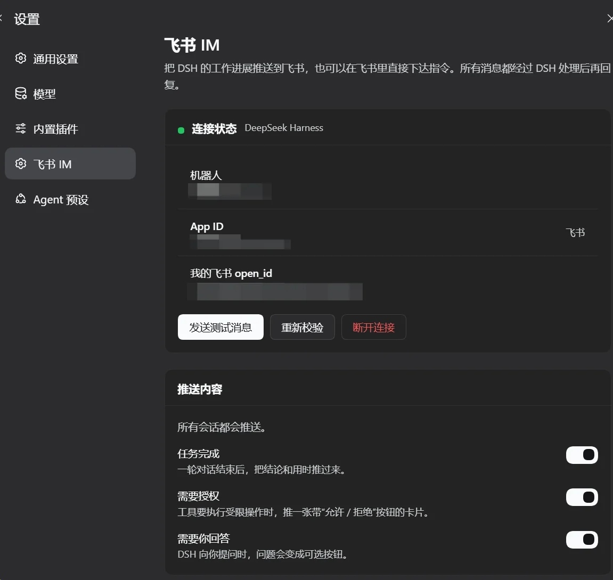
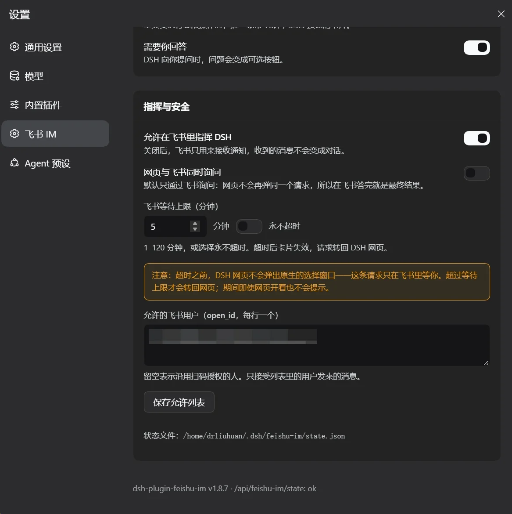
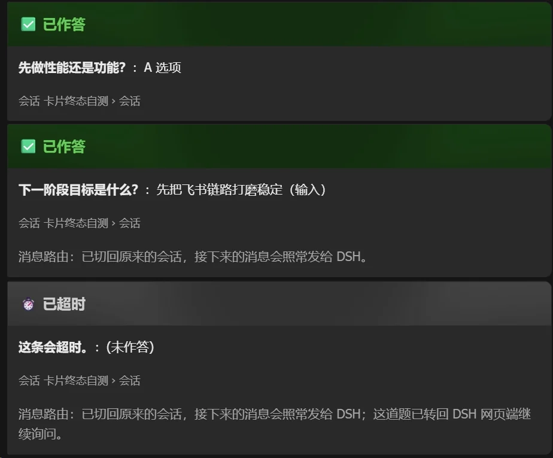
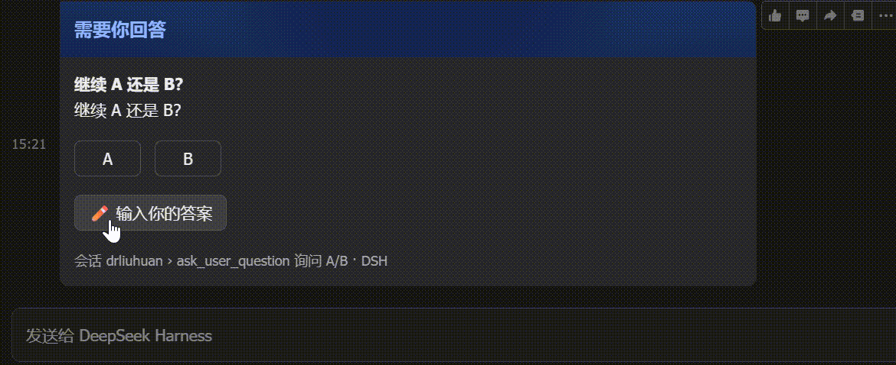
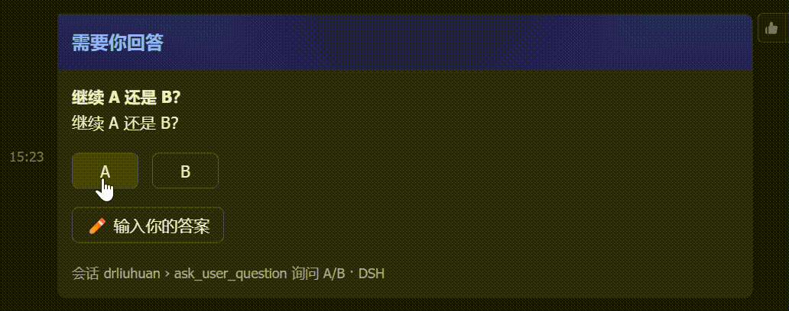
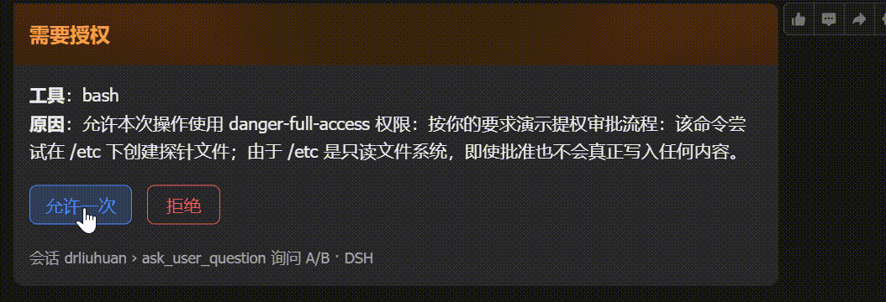
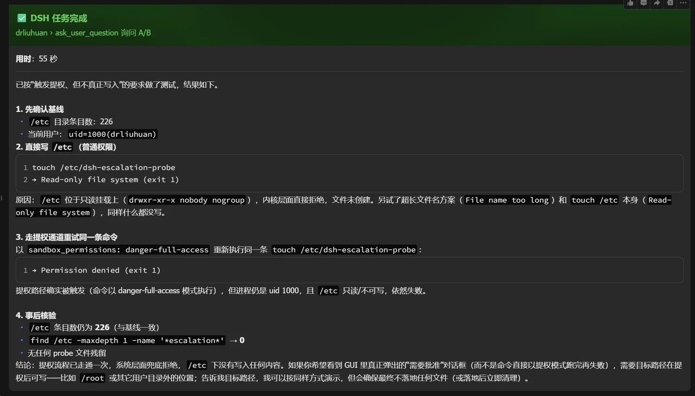
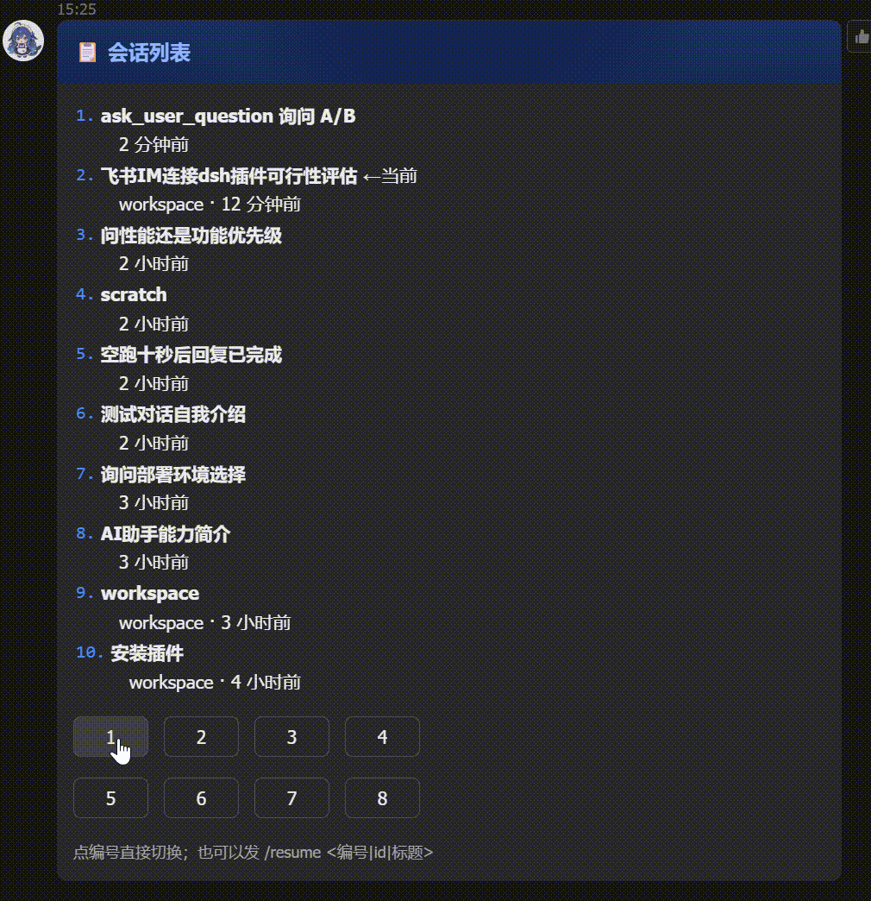

# dsh-plugin-feishu-im

[](https://www.npmjs.com/package/dsh-plugin-feishu-im)
[](./LICENSE)
[](https://github.com/drliuhuan/dsh-plugin-feishu-im/actions/workflows/release.yml)

[中文](./README.md) | **English**

A Feishu (Lark) IM channel for DeepSeek Harness: create a dedicated Feishu bot by scanning a QR code in
**Settings → Feishu IM**, receive task progress, approval requests and questions in Feishu, and drive DSH from the chat.



## What it does

| Capability | Behaviour |
|---|---|
| Connect | Scan to create a dedicated Feishu app (message scopes included), or paste an App ID / App Secret |
| Task notices | One card per finished turn: conclusion + duration, with the error when a turn fails |
| Approvals | A card with **Allow once / Reject**; the tool continues as soon as you tap |
| Questions | `ask_user_question` options become buttons, plus a **Type your answer** path |
| Progress | A `Typing` reaction on your message while working, `CrossMark` on failure |
| Control | Send a message in Feishu → it runs in a DSH session → the result comes back to the same chat |
| Steering | A message sent while a turn is running **joins that turn as guidance** instead of queueing, and the chat says so; `/queue` asks for the old queueing behaviour |
| Sessions | `/sessions` lists them, tap a number to switch, or `/resume <n\|id\|title>` |
| Permissions | Each chat picks one of four modes: read-only, workspace read-write, auto-review (plugin), full access |
| Where they live | New conversations go to a configurable folder (default `~/dsh-plugin-feishu-im`) under a configurable workspace title (default 飞书IM) |
| Rendering | Sent as **Card JSON 2.0**: headings, quotes, code blocks and tables render; long output paginates instead of being cut |

## Install

```bash
# from npm (recommended)
plugin_manager install_bundle dsh-plugin-feishu-im

# or
npm i -g dsh-plugin-feishu-im
```

Then open **Settings → Feishu IM**.

## Install as a service (no sudo)

**Settings → Deployment** can install DSH as a **user** systemd unit
(`~/.config/systemd/user/dsh.service`, `Restart=always`) without any sudo — which matters when the operator only has
the web UI or Feishu and no terminal to type a password into.

- The page first **detects whether DSH already runs as a service** (system or user level); the button is disabled when it
  is, and says which one owns the process.
- The option is disabled on Windows with a “Linux only (plus macOS launchd)” explanation.
- When nothing supervises the process, it warns that an exit or reboot will not restart DSH and that closing the terminal
  or logging out ends it.
- If a **system** `dsh.service` already owns the process, the plugin refuses to install a second, competing user unit.
- Surviving logout needs one root-time `loginctl enable-linger $USER` (already enabled on this host).
- Restarts then go through `systemctl --user restart dsh.service`; `scripts/restart-dsh.py` prefers it automatically and
  still runs the busy-check → Feishu notice → restart → "back up" notice sequence.

## Connecting to Feishu

### Scan to create (recommended)

1. Tap **Generate connection QR code** and scan it with the Feishu mobile app;
2. Confirm the creation prompt;
3. The page stores the credentials locally and verifies the bot identity.

The Feishu side uses the platform's device-code registration flow
(`accounts.feishu.cn/oauth/v1/app/registration`, `archetype=PersonalAgent`), so the created app already carries the
message scopes it needs. That endpoint is not part of Feishu's public documentation and may change; the UI falls back to
manual entry when it fails.

### Manual credentials

Bring your own app and fill in the App ID / App Secret. You must configure:

- the **Bot** capability
- scopes: `im:message`, `im:message:send_as_bot`, `im:resource`, `im:chat`
- event: `im.message.receive_v1` over **long connection**
- callback: `card.action.trigger` (the **Callback** tab, not Events — also over long connection)
- and publish an app version (scopes and callbacks do not take effect until you do; button taps fail with `200340`)

## How approvals and questions are routed



Approvals and questions go **to Feishu only** by default: the host does not forward the same request to the web UI,
so answering in Feishu is final and no web prompt is left waiting. Turning on **Ask in the web UI as well** restores
the parallel mode: both surfaces prompt, the first answer wins (a web prompt can outlive a Feishu answer until the turn
ends).

**Feishu wait limit**: 1–120 minutes, or *never time out*. When it expires the card is rewritten as **⏱ Timed out** and
the request goes back to the DSH web UI. During that window the web UI shows **no** native prompt — in exclusive mode the
request only exists in Feishu.

## Card states

Every terminal state rewrites the card in place; the option buttons are gone:



| Trigger | Title | Body |
|---|---|---|
| Option tapped | ✅ Answered | `question: answer` |
| Typed answer | ✅ Answered | `question: answer (typed)` |
| Input mode armed | ⌨️ Waiting for your answer | question + option labels + `(waiting)` |
| Timed out | ⏱ Timed out | `question: (unanswered)` + handed back to the web UI |
| Approval | ✅ Allowed / ❌ Rejected | tool, reason, result |

Cards that changed the chat's message routing also state it at the bottom, e.g. *“Routing: back to the original session;
later messages go to DSH as usual.”*

### Question card



Tap an option to answer inline, or tap **✏️ Type your answer** and send the answer as your next message.



### Approval card



### Task finished



## Session list and switching



`/sessions [keyword]` (alias `/history`) posts a numbered list card; tap a number to switch, or use
`/resume <n|id|title>`. The card is rewritten in place to show only the bound session title afterwards. Sub-agent
sessions are filtered out and the current binding is marked `← current`.

| Command | Purpose |
|---|---|
| `/sessions [keyword]`, `/history` | List sessions and switch |
| `/resume <n\|id\|title>` | Switch the bound session |
| `/current` | Show the current binding |
| `/new` | Start a fresh session |
| `/queue <text>` | Queue the message instead of steering |
| `/permission`, `/mode` | Show and switch this chat's permission mode |
| `/restart` | Restart DSH (refused while a task is running) |
| `/stop` | Ask the current session to stop |
| `/id` | Print the session id |
| `/help` | Command reference |

The model can do it too: the `feishu_sessions` tool (`list` / `current` / `switch`) lets the agent list or switch the
session bound to this chat, so “switch to the third session” works as plain language.

### Where a Feishu conversation lives

The **Feishu session location** settings control two things:

- **Working folder** — defaults to `~/dsh-plugin-feishu-im` and is created when missing;
- **Workspace title** — defaults to 飞书IM and groups these sessions in the workspace list; a rename is applied to the
  existing workspace when the next Feishu conversation is created.

Existing conversations keep their folder; send `/new` to start one in the new location.

## Session permissions

Every Feishu chat stores its own permission mode, applied to the session it is bound to:

| Mode | Sandbox | Approval | Meaning |
|---|---|---|---|
| Read-only | `read-only` | ask | Reads only; anything that crosses the line asks you |
| Workspace read-write | `workspace-write` | ask | Writes inside the workspace; crossing asks you |
| Auto review (plugin) | `workspace-write` | plugin decides | The plugin approves workspace-level requests itself; **anything asking for full access still asks you** |
| Full access | `danger-full-access` | never | No sandbox, no prompts |

**Switching takes two cards**: `/permission` (or the agent, through the `feishu_permission` tool) posts the four
modes; tapping one opens a **confirmation** card showing “from X → to Y”, and only 确认修改 applies it — 取消 changes
nothing. An unanswered confirmation turns into “⏱ timed out” and the mode stays put.

Under the hood the sandbox is a session-level `sandbox/mode` event, the approval side is `approval.setPolicy`, and `auto` deliberately keeps `ask` so the plugin can decide (it posts “🤖 auto-approved …” when it does). Settings sets the default for new sessions; `/permission` overrides one chat.

## Security model

- The App Secret lives only in `<DSH_HOME>/feishu-im/state.json` with mode `0600`; it never reaches the browser and is
  never written into `cordis.patch.yml`.
- The settings page talks to exact Fetch routes under `/api/feishu-im/*`, reachable only by the authenticated owner
  browser on this machine.
- Feishu messages are filtered by an `open_id` allowlist; the person who scanned the QR is added automatically. With an
  empty list the first sender is claimed as the sole user.
- With **Allow driving DSH from Feishu** off, Feishu only receives notices and carries no instructions.
- Dangerous operations still follow DSH's approval policy; a card only moves that same request to your phone.
- Do not run a second long connection for the same Feishu app elsewhere — Feishu delivers each event to one of them.

## Troubleshooting

Enable the host trace (off by default; `touch <DSH_HOME>/feishu-im/trace.on` also enables it live):

```bash
DSH_FEISHU_IM_TRACE=1 dsh web
```

The log is `<DSH_HOME>/feishu-im/host-probe.log`: route registration, connection lifecycle, turn events, delivery
results and card taps.

| Symptom | Likely cause |
|---|---|
| Settings page reports HTTP 404 | Plugin not active, or the `/api/feishu-im/*` routes were never registered |
| `gateway-failed` | Wrong App Secret, or no published app version |
| Button tap fails with `200340` | `card.action.trigger` not set as a long-connection callback, or no published version |
| No Typing reaction | The app lacks the message-reaction write scope; sending still works |
| Session shows as “unnamed” | Its title has not been generated yet; send one message and it fills in |
| A table shows only 5 rows | Card 2.0 markdown table limit; the client paginates the rest |

## Development

```bash
npm test              # tool-schema + answers-smoke + sessions-smoke + render-smoke
npm run test:render   # real React render of every page state (needs react/react-dom)
npm run test:live     # hits the real Feishu API, reads the cards back and asserts the three end states
npm run test:timeout  # hits the real Feishu API and walks the timeout hand-back
```

Releases run through `.github/workflows/release.yml`: a **trusted publisher (OIDC)** publishes with provenance and no
`NPM_TOKEN`. Push a `v*` tag.

## License

[MIT](./LICENSE)
