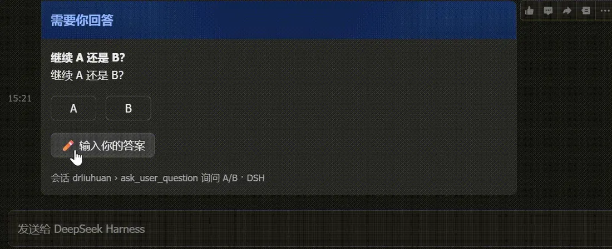
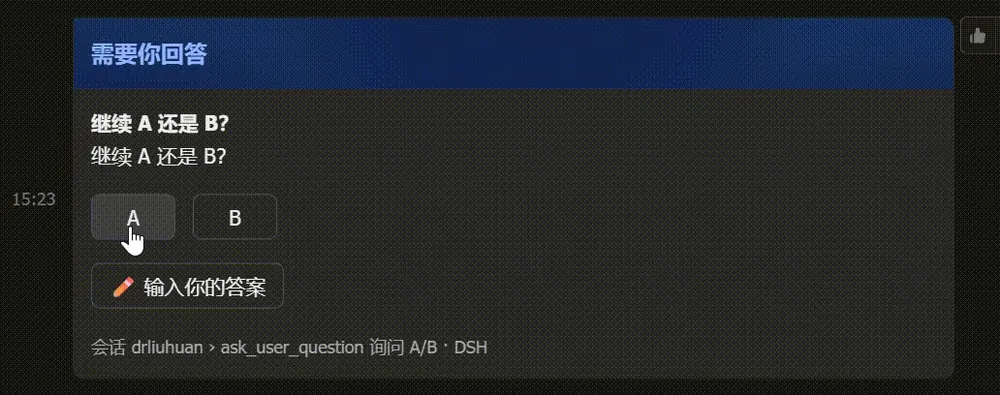
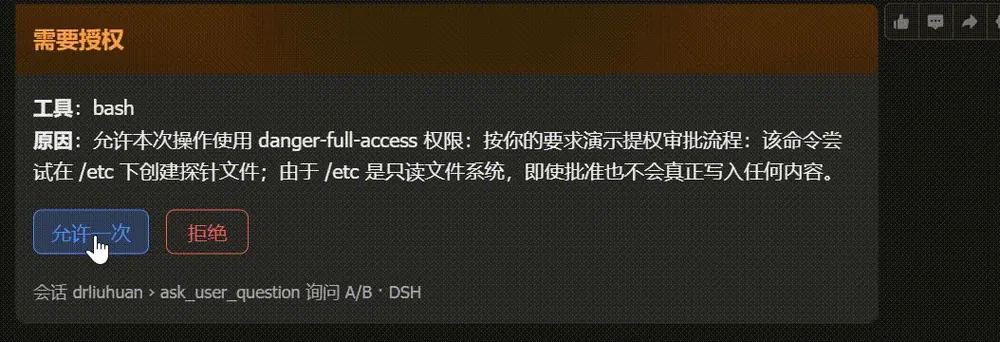
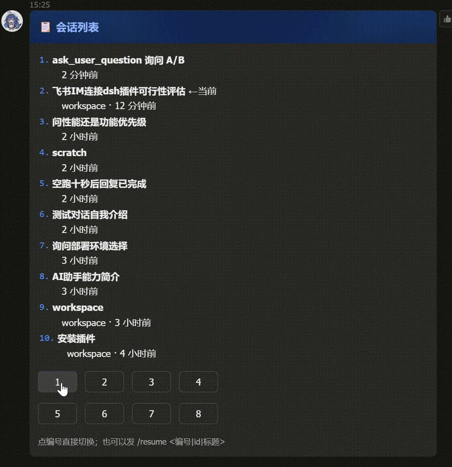

# dsh-plugin-feishu-im

[](https://www.npmjs.com/package/dsh-plugin-feishu-im)
[](./LICENSE)
[](https://github.com/drliuhuan/dsh-plugin-feishu-im/actions/workflows/release.yml)

**中文** | [English](./README.en.md)

DeepSeek Harness 的飞书 IM 通道：在 DSH Web 的「设置 → 飞书 IM」里扫码创建一个专属飞书机器人，
把任务进展、审批请求、提问推到飞书，并在飞书里直接指挥 DSH。


## 它能做什么

| 能力 | 行为 |
|---|---|
| 连接 | 扫码创建专属飞书应用（自动带上收发消息权限），或手动填 App ID / App Secret |
| 任务通知 | 任何会话一轮结束时推一张卡片：结论 + 用时，失败时带原因 |
| 审批 | 工具需要授权时推卡片，「允许一次 / 拒绝」，点完 DSH 继续跑 |
| 提问 | `ask_user_question` 的选项变成按钮；也能点「输入你的答案」用文字回答 |
| 进度 | 收到消息后在你那条消息上打 `Typing` 反应，处理完撤掉，失败换 `CrossMark` |
| 指挥 | 在飞书里发消息 → 进 DSH 会话执行 → 结果回传到同一个对话 |
| 会话 | `/sessions` 列会话、点编号切换，或 `/resume <编号｜id｜标题>` |
| 渲染 | 消息以 **卡片 JSON 2.0** 发送：标题、引用、代码块、表格都能渲染，超长按段分页不截断 |

## 安装

```bash
# 从 npm 安装（推荐）
plugin_manager install_bundle dsh-plugin-feishu-im

# 或者
npm i -g dsh-plugin-feishu-im
```

装好后进入 **设置 → 飞书 IM**。

## 连接飞书

### 扫码创建（推荐）

1. 点「生成连接二维码」，用飞书手机端扫码；
2. 按提示确认创建；
3. 页面自动拿到凭据、写入本机并校验机器人身份。

飞书这一侧用开放平台的设备码注册流程（`accounts.feishu.cn/oauth/v1/app/registration`，
`archetype=PersonalAgent`），创建出来的应用已带消息权限，不需要手动勾选。这条接口不在飞书公开文档里，
可能随平台演进；失败时界面会退回到手动填写。

### 手动填写

已有应用时直接填 App ID / App Secret，但需要自己配置：

- 开启「机器人」能力
- 权限：`im:message`、`im:message:send_as_bot`、`im:resource`、`im:chat`
- 事件：`im.message.receive_v1`（**长连接**）
- 回调：`card.action.trigger`（**回调配置**页，不是事件配置页；同样用长连接）
- 发布一个应用版本（权限与回调不发布会不生效，点按钮会报 `200340`）

## 指挥与询问策略


审批与提问默认**只走飞书**：宿主不把同一条请求转给网页，所以在飞书答完就是最终结果，不会留下一个还在等你的网页提示。
打开「网页与飞书同时询问」会恢复并行：两边都弹，谁先回答用谁（飞书先答时，网页那条要等本轮结束才消失）。

**飞书等待上限**：1–120 分钟，或「永不超时」。超时后卡片失效（原地改写为「⏱ 已超时」），请求转回 DSH 网页。
这段时间里 DSH 网页**不会**弹原生的选择窗口——独占模式下请求只存在于飞书。

## 卡片状态

所有卡片终态都是原地改写，选项按钮不再保留：


| 触发 | 标题 | 内容 |
|---|---|---|
| 点选项 | ✅ 已作答 | `问题：答案` |
| 输入文字 | ✅ 已作答 | `问题：答案（输入）` |
| 进入输入 | ⌨️ 等待你输入答案 | 原问题 + 选项文字 + `(等待输入)` |
| 超时 | ⏱ 已超时 | `问题：(未作答)` + 已转回 DSH 网页 |
| 授权 | ✅ 已允许 / ❌ 已拒绝 | 工具、原因、结果 |

改变过消息路由的卡片会在底部标明当前路由，例如「消息路由：已切回原来的会话，接下来的消息会照常发给 DSH。」

### 提问卡片



点选项直接作答，或点「✏️ 输入你的答案」后在下一条消息里写答案。



### 授权卡片



### 任务完成


## 会话列表与切换



`/sessions [关键字]`（别名 `/history`）发一张带编号按钮的列表卡，点编号即切换；也可以 `/resume <编号|id|标题>`。
切换后就地改写那张卡，只保留目标会话标题。列表会过滤子代理会话，并标出当前会话（`←当前`）。

| 命令 | 作用 |
|---|---|
| `/sessions [关键字]`、`/history` | 列会话并切换 |
| `/resume <编号\|id\|标题>` | 切换当前会话 |
| `/current` | 看当前绑定 |
| `/new` | 开一个新会话 |
| `/stop` | 让当前会话停下 |
| `/id` | 当前会话 id |
| `/help` | 命令说明 |

模型也能用：内置工具 `feishu_sessions`（`list` / `current` / `switch`），在飞书发起的会话里可以直接说「切到第 3 个会话」。

## 安全模型

- App Secret 只存在 `<DSH_HOME>/feishu-im/state.json`，权限 `0600`，不回传浏览器、不写进 `cordis.patch.yml`；
- 设置页的接口是 DSH 的 exact Fetch 路由（`/api/feishu-im/*`），只有本机已认证的 owner 浏览器能访问；
- 飞书侧按 `open_id` 允许列表过滤，扫码授权的人自动进入列表；列表为空时接受第一个来消息的人并设为唯一使用者；
- 关闭「允许在飞书里指挥 DSH」后，飞书只收通知，不接指令；
- 危险操作仍走 DSH 的审批策略；卡片只是把同一次请求搬到手机上回答；
- 同一个飞书应用不要在别处同时开长连接（飞书会把事件随机投给其中一条）。

## 排障

打开宿主追踪（默认关闭，也可 `touch <DSH_HOME>/feishu-im/trace.on` 运行时打开）：

```bash
DSH_FEISHU_IM_TRACE=1 dsh web
```

日志在 `<DSH_HOME>/feishu-im/host-probe.log`：路由注册、长连接起停、turn 事件、通知发送、卡片点击。

| 症状 | 多半原因 |
|---|---|
| 设置页报 HTTP 404 | 插件没激活，或 `/api/feishu-im/*` 路由没注册 |
| 长连接 `gateway-failed` | App Secret 不对，或应用没发布版本 |
| 点按钮报 `200340` | `card.action.trigger` 没配成回调 + 长连接，或没发布版本 |
| 没有 Typing 徽标 | 应用缺消息 reaction 写权限，不影响收发 |
| 名字是「未命名会话」 | 该会话还没生成标题，发一条消息后会补上 |
| 表格只显示 5 行 | 卡片 2.0 的 markdown 表格限制，其余由客户端分页 |

## 开发

```bash
npm test              # tool-schema + answers-smoke + sessions-smoke + render-smoke
npm run test:render   # 真 React 渲染每个页面状态（需要 react/react-dom）
npm run test:live     # 真连飞书，回读卡片内容并断言三种终态
npm run test:timeout  # 真连飞书，走一遍超时转回
```

发布走 `.github/workflows/release.yml`：**trusted publisher（OIDC）** 自动发布并生成 provenance，不使用 `NPM_TOKEN`。
push 一个 `v*` tag 即可。

## License

[MIT](./LICENSE)
